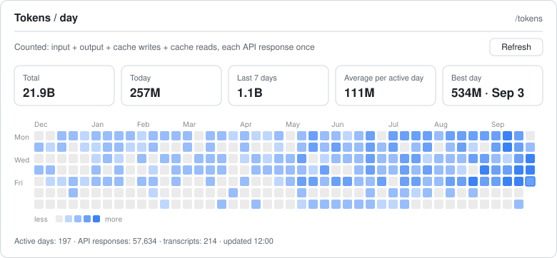

# Token Heatmap for Claude Code

**A `/tokens` pane that shows how many tokens you use each day, as a heatmap.**

Claude Code's built-in statistics count sessions and messages. This plugin shows the number that actually describes your usage: **tokens per day**. Every API response is counted exactly once, so the totals aren't inflated.

<picture>
  <source media="(prefers-color-scheme: dark)" srcset="docs/preview-dark.svg">
  
</picture>

<sub>Preview drawn with synthetic data by <code>scripts/preview.mjs</code>.</sub>

---

## Contents

- [Features](#features)
- [Requirements](#requirements)
- [Installation](#installation)
- [Usage](#usage)
- [What counts as a token](#what-counts-as-a-token)
- [Why the totals differ from the built-in stats](#why-the-totals-differ-from-the-built-in-stats)
- [Configuration](#configuration)
- [How it works](#how-it-works)
- [Privacy](#privacy)
- [Troubleshooting](#troubleshooting)
- [Uninstalling](#uninstalling)
- [Development](#development)
- [How this was built](#how-this-was-built)
- [Po polsku](#po-polsku)
- [License](#license)

## Features

- **`/tokens`** opens a pane in Claude Code. It works in the desktop app, the terminal and VS Code.
- **Five tiles:** Total, Today, Last 7 days, Average per active day, Best day.
- **Heatmap** of the last months, with weeks as columns and Monday first. Hover a day to see its exact total and a breakdown by model (desktop app and VS Code).
- **Terminal fallback:** the last 14 days drawn as bars.
- **Numbers that read at a glance:** `600M`, `1.2B` in English; `600 mln`, `1,2 mld` in Polish.
- **English and Polish UI**, picked automatically from your system locale.
- **Fast:** an incremental cache means only new transcript data is read. On a 2.7 GB history the first count took about 5 s; later ones take about 0.2 s.
- **Keeps your history** after Claude Code's automatic cleanup deletes old transcripts.
- **Local only:** nothing leaves your machine (see [Privacy](#privacy)).

## Requirements

| | |
|---|---|
| **Claude Code** with plugin *hooks modules* (the early-access API behind “mods”: panes, bands, slash commands written in TypeScript) | Built and tested against Claude Code **2.1.295**. The API is early access and may change between releases. |
| **Node.js 18 or newer** | Must be reachable as `node`, or set the [`nodePath`](#configuration) option. The token counter runs as a separate Node.js process. |

## Installation

### Option A: from the plugin marketplace (recommended)

Inside Claude Code:

```
/plugin marketplace add vus955-gif/claude-code-token-heatmap
/plugin install token-heatmap@claude-code-token-heatmap
```

Or from a shell:

```bash
claude plugin marketplace add vus955-gif/claude-code-token-heatmap
```

```bash
claude plugin install token-heatmap@claude-code-token-heatmap
```

Start a new session and type `/tokens`.

The installer may report that two options aren't set yet. You can ignore that: both have defaults (see [Configuration](#configuration)).

### Option B: from a clone

```bash
git clone https://github.com/vus955-gif/claude-code-token-heatmap.git
```

Then load the folder in one of two ways.

**For one terminal session:**

```bash
claude --plugin-dir /path/to/claude-code-token-heatmap
```

**For every session, including the desktop app:** add the folder to the `env` block of `~/.claude/settings.json`:

```json
{
  "env": {
    "CLAUDE_CODE_PLUGIN_DIRS": "/path/to/claude-code-token-heatmap"
  }
}
```

On Windows use the full path with escaped backslashes, e.g. `"C:\\path\\to\\claude-code-token-heatmap"`. To list several folders, separate them with `;` on Windows and `:` on macOS and Linux. To update a clone, run `git pull` and start a new session.

## Usage

1. Type **`/tokens`**. The pane opens and the count starts at once.
2. Hover over a day in the heatmap to see its total and how it splits between models.
3. Press **Refresh** at any time to pick up the latest usage.

The first count reads your whole transcript history and can take a few seconds. After that, only data written since the previous count is read.

| Tile | Meaning |
|---|---|
| Total | All tokens across the history the plugin knows about |
| Today | Tokens since local midnight |
| Last 7 days | Today plus the six days before it |
| Average per active day | Total ÷ days with any usage |
| Best day | The day with the most tokens, and its date |

## What counts as a token

Every API response reports four counters. The pane shows **one number, the sum of all four**:

| Counter | What it is | Typical share |
|---|---|---|
| `input_tokens` | New, uncached input | Tiny |
| `output_tokens` | What the model wrote | Small |
| `cache_creation_input_tokens` | Context written to the prompt cache | A few % |
| `cache_read_input_tokens` | Context read back from the cache on every step | **Usually 90%+** |

Cache reads dominate because every step of an agentic session reads the whole conversation again (cheaply, from the cache). That's why daily totals reach hundreds of millions of tokens even though far less text was written.

If you want a different definition, it's one function: `tokensOf()` in [`hooks/lib.ts`](hooks/lib.ts).

## Why the totals differ from the built-in stats

Claude Code stores each API response in its transcript (`~/.claude/projects/**/*.jsonl`) as **several lines**: one per content block (thinking, text, each tool call). **Every one of those lines carries the full `usage` of the response.** Adding up line by line therefore counts most responses two, three or more times.

In one real 30-day history:

| Method | Total |
|---|---|
| Sum of `usage` over every line (matches the built-in total) | 10.5B |
| Each API response counted once (this plugin) | **4.5B** |

The plugin de-duplicates by `message.id`. While a response is streaming, earlier lines can hold a partial output count, so the largest one wins. It also de-duplicates across files, because resumed sessions and subagents can repeat the same response.

## Configuration

| Option | Values | Default | Effect |
|---|---|---|---|
| `language` | `auto`, `en`, `pl` | `auto` | Language of the pane. `auto` picks Polish for a Polish system locale and English otherwise. The locale is `LC_ALL`, `LC_MESSAGES` or `LANG` when one is set, otherwise the system's region setting. |
| `nodePath` | a command or a full path | `node` | How the token counter is started, e.g. `/opt/homebrew/bin/node` |

Set them with `/plugin configure token-heatmap@claude-code-token-heatmap` inside Claude Code, or from a shell:

```bash
echo '{"language":"pl"}' | claude plugin configure token-heatmap@claude-code-token-heatmap --values-stdin
```

or directly in `~/.claude/settings.json`:

```json
{
  "pluginConfigs": {
    "token-heatmap@claude-code-token-heatmap": {
      "options": { "language": "pl" }
    }
  }
}
```

For a clone loaded with `--plugin-dir` or `CLAUDE_CODE_PLUGIN_DIRS`, the key is `token-heatmap@inline`.

## How it works

```
~/.claude/projects/**/*.jsonl                   transcripts written by Claude Code
            │
            ▼
scripts/aggregate.mjs   (Node.js, run on /tokens and on Refresh)
  • reads only what changed since the last run (JSONL files only grow)
  • counts each API response once (by message.id, across all files)
  • keeps per-response totals in ~/.claude/token-heatmap/cache.json
  • prints { days: { "YYYY-MM-DD": { model: [input, output, cacheWrite, cacheRead] } } }
            │
            ▼
hooks/register.tsx      (the plugin's hooks module inside Claude Code)
  • registers /tokens and opens the pane
  • keeps the report in session state; the pane redraws when it changes
  • draws the tiles, plus an SVG heatmap (desktop, VS Code) or bars (terminal)
```

- **Incremental reads.** The cache remembers each transcript's size and how far it was read. An unchanged file is skipped; a file that grew is read only from where the last run stopped.
- **Surviving cleanup.** Claude Code deletes transcripts older than `cleanupPeriodDays` (30 by default). When a transcript disappears, its per-response totals move to an archive inside the cache, so those days stay on the heatmap.
- **Local days.** A response belongs to the day of its timestamp in your local time zone. The cache keeps the timestamp, and the day is worked out on every count, so after you change time zones the whole history follows.

## Privacy

- The plugin **reads** only `~/.claude/projects` (or `$CLAUDE_CONFIG_DIR/projects`).
- It **writes** only `~/.claude/token-heatmap/cache.json`. For each API response, the cache holds its message id, time, model name and the four token counts. **No prompts, replies or file contents.**
- The cache does list your transcripts by their full paths, e.g. `~/.claude/projects/-home-me-work-acme/<session id>.jsonl`. Claude Code names those folders after your project folders, so the cache shows which folders you used Claude Code in, as `~/.claude/projects` itself does. Keep that in mind before you share the file.
- It makes **no network requests**.
- Delete `~/.claude/token-heatmap/` at any time. The next count rebuilds it from the transcripts that still exist.

## Troubleshooting

**`/tokens` doesn't exist.** Start a new session after installing, and check that the plugin is enabled (`/plugin`). Hooks modules are early access: if they're switched off in your build, set `CLAUDE_CODE_ENABLE_FUNCTION_HOOKS=1` in the `env` block of `~/.claude/settings.json`.

**“Could not run "node"”.** Install Node.js 18+ or set `nodePath` to its full path. Desktop apps on macOS often don't see the shell's `PATH`, so use e.g. `/opt/homebrew/bin/node` or `/usr/local/bin/node` (run `which node` in a terminal to find yours).

**“The count was stopped after 5 minutes”.** One count may run for 5 minutes; a normal first count takes seconds. A slow or network drive, or an antivirus scanning every transcript, can make it longer. Press **Refresh** to try again.

**“Transcripts that could not be read: N”.** The counter could not open N transcript files, for example because another program held them. It tries them again on the next count; until then their tokens may be missing from the totals.

**The totals are lower than the built-in panel's.** That's expected; see [Why the totals differ](#why-the-totals-differ-from-the-built-in-stats).

**The heatmap starts only a few weeks back.** The plugin can only count transcripts that still exist when it first runs, and by default Claude Code keeps about 30 days. From the first run on, history is kept. To keep more transcripts as well, raise `cleanupPeriodDays` in `~/.claude/settings.json`.

**No tooltips in the terminal.** The terminal shows the last 14 days as bars. Hover details are a desktop and VS Code feature.

## Uninstalling

```
/plugin uninstall token-heatmap@claude-code-token-heatmap
/plugin marketplace remove claude-code-token-heatmap
```

Then delete `~/.claude/token-heatmap/` (the cache). For a clone, remove the folder from `CLAUDE_CODE_PLUGIN_DIRS` and delete it.

## Development

```
.claude-plugin/
  plugin.json          manifest: name, version, options (userConfig), types
  marketplace.json     makes this repository a one-plugin marketplace
hooks/
  hooks.json           points Claude Code at the hooks module
  register.tsx         /tokens, the pane, refreshing
  lib.ts               pure helpers: counting, EN/PL strings, formatting, heatmap SVG
scripts/
  aggregate.mjs        the token counter (Node.js)
  preview.mjs          draws docs/preview-*.svg from synthetic data
tests/
  render.test.tsx      the pane in English and Polish, on desktop and in the terminal
  aggregate.test.mjs   the token counter on synthetic transcripts (node --test)
types/
  index.d.ts           the report's shape and the plugin's state contract
.github/workflows/
  ci.yml               runs both test suites on every push and pull request
```

Test the token counter with Node.js (18 or newer). The tests build synthetic transcripts in a temporary folder and never read your own `~/.claude`:

```bash
node --test tests/aggregate.test.mjs
```

Check and test the pane with the Claude Code CLI:

```bash
claude plugin validate .
```

```bash
claude plugin test .
```

Regenerate the README previews (Node.js 23.6+ imports `.ts` directly; on Node.js 22 add `--experimental-strip-types`):

```bash
node scripts/preview.mjs
```

While Claude Code has the plugin loaded, it writes type declarations into `.claude-plugin/types/` and a `tsconfig.json`. Both are git-ignored. The plugin API reference comes from Claude Code itself: run `/plugin-types` in a session.

## How this was built

The plugin was built in a Claude Code session, using Claude Code's own plugin hooks API. The author set the goal and made the design calls: which number to show, how to count it, how to format it. Claude did the investigation (including finding why line-by-line sums double count) and wrote the code, tests and this README. Each step was checked with `claude plugin validate`, `claude plugin test` and runs against a real 2.7 GB transcript history.

## Po polsku

Wtyczka dodaje do Claude Code komendę **`/tokens`**. Otwiera ona panel z liczbą tokenów zużytych w każdym dniu: kafelki (łącznie, dziś, ostatnie 7 dni, średnia, rekordowy dzień) i heatmapę. Każda odpowiedź API jest liczona raz, więc wyniki nie są zawyżone jak we wbudowanych statystykach. Przy polskich ustawieniach systemu interfejs jest po polsku (`1,2 mld`, `600 mln`). Język można też wymusić opcją `language`. Instalacja: dwie komendy z sekcji [Installation](#installation).

## License

[MIT](LICENSE) © vus955-gif
